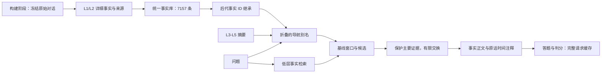

# TiMEM / AML 记忆证据优化：从问题定位到五层导航的实现与结果

日期：2026-10-25。用途：项目 GitHub PR 的完整成果说明。最终分数已包含两题跨问题缓存修正。

## 1. 当前成果

在 TiMEM 已有五层架构上，我们完成了可追溯原文证据、逐事实时间标注、统一事实继承、高层摘要导航、重复路径折叠、受保护证据选择和可审计评测的本地参考实现。

最终本地 LoCoMo-Refined 861 题中，五层导航方案 H 为 **728/861，84.55%**；同一轮、同一事实库的低层基线 B 和低层重排 L 均为 **723/861，83.97%**。H 净多答对 **5 题，+0.58 个百分点**。

| 类别 | 题数 | B：低层原始证据 | L：低层候选重排 | H：高层参与重排 | H−B 题数 |
|---|---:|---:|---:|---:|---:|
| 时间 | 167 | 131，78.44% | 131，78.44% | 132，79.04% | +1 |
| 单跳 | 581 | 505，86.92% | 508，87.44% | 511，87.95% | +6 |
| 多跳 | 77 | 54，70.13% | 52，67.53% | 53，68.83% | −1 |
| 推理 | 36 | 33，91.67% | 32，88.89% | 32，88.89% | −1 |
| **总体** | **861** | **723，83.97%** | **723，83.97%** | **728，84.55%** | **+5** |

高层的实际作用已能追踪到事实：78 道题通过高层路径选入了原基线未呈现的事实，共 101 项；这些题相对 B 为 6 转对、1 转错，净 +5。H 另有 72 道仅改变低层候选，4 转对、4 转错，净 0。

H−L 为 9 转对、4 转错，双侧精确 McNemar p=0.26685；H−B 为 10 转对、5 转错，p=0.30176。因此可以报告“观察到小幅正收益，并据此阶段冻结”，不能写成“已证明显著提升”或“四类任务全部提升”。

## 2. 原有系统基础，以及本项目新增了什么

### 原有能力

TiMEM 原仓库已包含 L1 片段、L2 会话、L3 日、L4 周和 L5 高层记忆模块。我们接手 AML 实验时，也已经有 `time_anchor.py`、用户归属校验、L2 防抖补齐和一跳实体扩展。

这些能力是本项目的基础，不能归为本轮新增架构或原创算法。交接文档的 80.5% 是一段对话 87 题的三次中位数，不能直接与本报告的 861 题分数相减。

### 新增贡献的落地范围

| 范围 | 已实现的内容 | 当前落点 |
|---|---|---|
| 实验底座 | 全量题单、逐题来源、同轮对照、冻结输入、错误与重试记录 | 本地评测工程和实验目录 |
| 原文证据 | 每条消息自己的时间、角色、稳定来源 ID、邻近上下文、FTS5 检索 | AML 源码副本模块及已运行实验 |
| 时间解释 | 日/月/年日历值、周/周末参照日、粒度及来源注释 | 冻结时间实验模块 |
| 五层存储 | 可复现快照、逐事实日期、父层范围与事实时间分离、事实 ID 继承 | 本地 JSON / SQLite 快照 |
| 高层检索 | 高层摘要作为导航，命中后回到底层事实，折叠重复路径 | `grounded.py`、路由索引及 V2 候选程序 |
| 证据选择 | 中心窗口、保护前 20 窗口、最多 4 换 4、完整筛选提示、失败回退 | 本轮全量实际执行器 |
| 评测可靠性 | 按问题和完整模型请求缓存、两题定向修正、最终配对复算 | 修正后的评分程序和原始调用记录 |

当前五层主体属于**本地离线参考实现**。它尚未整体迁移进 TiMEM 核心包或太忆空间云端生产 API；实验脚本仍有本机绝对路径。源码副本中存在模块，不代表生产入口已经全部接线。

## 3. 整条证据链如何变化

最初发现的问题是：Add 的一个输入块可能跨多次会话，摘要却把块首日带给后面的事件；分层摘要还会重复改写和压缩事实。增加检索条数无法自动修复这些错误。

早期优化增加原文证据旁路，再给原文里的时间词加独立解释。后期五层实验则把已有 L1/L2 事实固定下来，让 L3–L5 负责帮助找到事实。



最终五层测试运行期只读已存事实、索引及时间注释，不重新检索 L0 原文。高层找到的仍是共享事实库中的内容；收益来自选到了更合适的事实，不是凭空添加新知识。

## 4. 逐项优化及具体落实实例

### 4.1 扩展全量评测，并修复异步检索中的阻塞

从单段小卷扩展到 10 段对话、861 题；首轮 299 个输入块全部写入，861 题全部完成检索和评分，空检索与判分解析错误均为 0。

Search 中原有用户归属检查会同步访问数据库，现改为：

```python
# 原有检查规则保留，将阻塞工作移出事件循环。
rows = await asyncio.to_thread(filter_owned, body.user_id, rows)
```

实际改进的是运行可靠性；用户隔离规则原来就存在。补丁落点：`locomo_full_20261022/runtime_fix.diff`。

### 4.2 保存逐条原文来源，解决跨会话块首日污染

299 个 Add 块中有 236 个跨多个会话时间。新增 SQLite FTS5 原文索引，保存消息自己的 `observed_at`、角色、用户/会话/请求、位置和稳定 `source_id`；时间缺失时保留未知。

**真实实例：Melanie 的慈善跑步。**

旧摘要把该事件放在 5 月 8 日，并写：

```text
last Saturday (2023-05-06)
```

实际原句来自 5 月 25 日：

```text
source_id=src:a46d20cb5776ef4628315757d33dd401
observed_at=2023-05-25T05:14:00+00:00
assistant: ... I ran a charity race for mental health last Saturday ...
```

相对于 5 月 25 日解释，上周六应为 5 月 20 日。新证据通道保留这条原句自己的发言时间，避免继续沿用块首日 5 月 8 日。

实现：`server/source_evidence.py`，冻结版本在 `locomo_smoke300_20261022/`。这不是全面重写旧摘要；旧摘要仍保留，可通过原文证据纠正其影响。

### 4.3 以命中消息为中心取上下文，并保留来源和摘要身份

原文检索取中心消息及前后两条，必要时保留会话开头称呼，限定同用户、同会话时间；以来源去重。摘要段显式标为 `Derived memory summary:`，不冒充逐字原话。相同 request_id 重复提交相同内容幂等，不同内容拒绝静默覆盖。

**真实实例：Jon 和 Gina 的共同点。**

题 `conv-30#q0003` 原答案只说“都喜欢当代舞”。原文邻近窗口带出了两人各自的经历，改为“都失去工作，并开始自己的事业”。

作用是保留跨句关系所需的上下文，不是把所有相同人物的内容都算成相关证据。实际模块已用于实验；当时 Add/Search 产品入口补丁是 staged 状态，未把它宣称为线上默认功能。

### 4.4 追加确定性日历注释，保留原话的时间粒度

只对保守识别的日期主问追加注释。原文、排序和事件措辞保留；依据原句自己的时间换算日/月/年，来源 ID 和原文字符位置可核验。检索和转换过程不读取金标、任务类别或官方证据标签。

**真实实例：五月说“下个月露营”。**

```text
原句：We're thinking about going camping next month.
发言时间：2023-05-25T05:14:00+00:00

新增解释：
source_id=src:9c8327c28393d9ee2837c93a7b113266
raw_phrase="next month"
calendar_value=2023-06
precision=month
rule=next_month
```

证据明确为“2023 年 6 月”，不会补成“6 月 1 日”，也不会把“计划去”改成“已经去”。`precision` 在初版 A0 已经存在，后续不是第一次发明粒度字段。

代码：`locomo_temporal_v2_20261023/patch/temporal_evidence.py`，后续使用冻结副本。

### 4.5 比较简短与复杂时间格式，选择经过验证的分支

实际测试 C0 无注释、C1 短注释、C2 更显式字段、C3 更显式字段加解析修复。C3 的原文 span、复杂短语边界、关联与去重修复是真实代码改动，但它没有取得更好成绩。

同轮全量 C0 为 697/861，C1 为 714/861；时间 89/167→106/167，其他三类持平。C2、C3 分别为 707、703，因此后续采用 C1 路线。

**具体差别：** `conv-41#q0018` 中 C1 输出 `Last month (March 2023)`，C3 只输出 `Last month`。这展示当轮模型输出差异，不能把全部收益单独归因于“字段少”，也不能说复杂解析修复没有技术价值。

### 4.6 W0 给周和周末补参照日，保留粗粒度

对简单 `last week` 和 `last weekend` 追加参照日，不武断给出某一天。W1 另行实验过精确周区间，但没有作为后续主方案采用。

**真实实例：** 3 月 27 日说新工作开始于 `last week`，新增表示：

```text
raw_phrase="last week"
observed_at=2023-03-27...
anchored_value="the week before March 27, 2023"
precision=week
```

题 `conv-26#q0008` 的实际答案从 `Last week.` 变为 `The week before June 9, 2023`。同轮 W0 时间 108→118，其他类持平，总体 719→729。

代码：`locomo_temporal_week_20261023/frozen/week_ext.py`。主方案没有把所有周表达强制转换为周一到周日。

### 4.7 构建可复现的五层快照

从 5,882 条冻结原始消息、10 段对话生成 1,236 个节点：L1 399、L2 272、L3 272、L4 207、L5 86。L1 每段不超过 20 条 turn，L2 按会话，L3 按日，L4 按月内周范围，L5 按月分组。

节点保存覆盖区间和子节点引用，便于反复比较相同输入。这里是将原有分层架构落实成受控实验快照，不是新增一套五层理论。

代码：`locomo_space_l1_l5_20261024/build_hierarchy.py`。

### 4.8 高层 W0 存储：归档范围与事实时间分离

保留原有 671 个 L1/L2 节点，改造 565 个 L3–L5 节点。`window` 只表示汇总覆盖范围，`fact_units[].observed_at` 表示事实来自哪次观察；短时间注释持久保存原词、来源、span、观察时间、粒度及日历值/周锚点。

**真实实例：Melanie 的陶盘。**

```text
月摘要覆盖：2023-08-14 至 2023-08-28，仅用于归档。
事实：8 月 25 日，Melanie 说昨天在陶艺课做了盘子。
原词：yesterday
事实观察日：2023-08-25
日历解释：2023-08-24，粒度为天。
来源：src:ae0f239c1037e7d0486ad4b4b9c7cd0f
```

“昨天”相对 8 月 25 日计算，月摘要结束日 8 月 28 日不参与换算。旧摘要本来已有 8 月 25 日，因此不能虚构其曾实际错算为 8 月 27 日；新结构明确排除了字段混用。

短语采用最长完整匹配，避免把 `last week` 匹配进 `last weekend`，或把 `yesterday` 匹配进 `day before yesterday`。构建阶段可读 L0 验证短语，测试阶段只读已存注释。

代码：`locomo_upper_w0_20261024/upper_w0.py`。

### 4.9 修复整个证据误用 8,000 字符上限

首版五层全量有 821/861 题触及 8,000 字符上限。该值本来只限制新增时间注释，却被用于全部证据。

修复后，主证据恢复 `format_memories` 的 token 预算，8,000 字符仅限制新增注释。以机制示意说明：检索找到 A/B/C 三段后，不应因为注释区上限而让正文只剩 A。

该修复与上层时间存储改造共同使对应全量从 542/861 到 694/861；缺少预算单改的全量组，不能将这 152 题全部计为时间结构本身的收益。

### 4.10 统一事实库与继承引用，停止逐层重复提供摘要正文

把 L1/L2 中“同一对话、同一观察时间、规范化正文相同”的内容合为 7,157 个事实，保留多份来源。L2 继承 L1 的详细事实；L3–L5 确定性继承后代事实 ID，不再反复改写这些事实。

**真实实例：同一陶盘事实。**

L1 和 L2 的陶盘记录合为 `fact:182f4bde298fa4b9097008ec35fb3c47`，保留两层来源。L3/L4/L5 三个陶盘摘要都指向它。最终正文只输出一次，日期来自同一条事实。

高层摘要作为目录和检索别名保留，链接仅限真实后代。无合格链接的上层摘要不直接作为答案事实。词面链接不被当作语义完全正确的证明，同义改写也未全部归并。

代码和数据：`locomo_hierarchy_grounded_20261024/grounded.py::construct()`、`store.json`、`index.sqlite`。

### 4.11 高层找到会话后，保留能提供答案的邻近事实

高层和底层使用分开的 FTS5 通道，按对话隔离；高层命中返回同一事实库，窗口不跨观察时间。目标附近各两条、必要时会话开头两条用于保留回应和称呼。

**真实实例：三款推荐游戏。**

题 `conv-48#q0054` 问 Jolene 推荐什么游戏。低层证据缺名称，答为 `Video games.`。高层定位 8 月 18 日会话，命中中心本身是对方的回应，邻近事实则提供：

- `fact:cf9cd94d0ebfd3e0b5d3ad52a44e7d27`：Zelda BOTW、Animal Crossing: New Horizons。
- `fact:3f4f32d2b354241bfdf0d6170e68c010`：Overcooked 2。

联合组补全三款。这个历史实例说明了高层定位加上下文的价值，不宣称后续每个版本都重复得到同一结果。

早期 R1 曾错误地拿分组前七条，导致命中第十条却没有输出第十条；后续恢复以目标为中心的窗口，并检查目标确实进入最终证据。

### 4.12 折叠高层重复路径，保留别名和来源

16,950 条高层路由按相同对话和目标事实集合折叠为 6,581 组。`aliases` 保留不同层摘要的说法，`provenance_levels` 保留 L3/L4/L5，`independent_support=1` 避免重复投票。

**实例：** 日、周、月摘要都指向陶盘事实时，程序保留三个寻找入口，但不会输出三次陶盘正文或把它们当成三份独立证明。

代码：`locomo_hierarchy_relevance_r1_20261024/tools/build_routes.py`。

### 4.13 保护主要证据，最多进行有限替换

原方案允许高层广泛增补，可能把模型带向邻近话题。最终基线最多 24 个窗口，前 20 个保持，最多替换末尾 4 个；不符合查询扩展条件的问题保持 B。guard 判断依赖问题文本，不读取题目类别标签。

**真实反例：** 问 Joanna 来 Nate 家时做什么，正确“看电影或去公园”在两组均存在，加入额外上下文后却回答“尝椰奶冰淇淋”。这促使我们把“新增信息是否支持本题”作为目标，而非追求更多内容。

后续曾用实体/关系类型槽位判断新增价值，但“推荐另一款游戏”容易被误当成相同类型重复。又尝试具体答案值和问题条件规则。它们没有形成稳定收益，最终主链使用模型联合比较整套可替换证据。

等量交换约束针对窗口数，不保证事实条数不减少，也不保证尾部的每条必要支持都保留。真实例 `conv-26#q0002` 的 H 用 c3 替换 t1，移除 5 条事实、补入 1 条，最终从 124 条变为 120 条；前 20 个窗口受到保护，尾部交换的语义效果仍需用最终答题验证。

### 4.14 V2 候选入口：让高层有机会带来基线之外的事实

L 取 12 个低层候选；H 取 8 个低层加最多 4 个高层候选，不足时低层回填。高层依据折叠 aliases 的查询相关度排序，低层使用 BM25 有序检索。

旧逻辑错误排除了低层扫描过的所有事实。V2 只排除已在 B 及 H 实际选中的低层内容，从而让高层命中有机会进入候选。候选由单条目标事实组成，保留稳定 ID 和完整正文。

离线准备中，407 道允许筛选题里有 402 道生成不同于 L 的 H 候选池；这是候选形成差异，不能当成 402 道答案改善。

代码：`locomo_hierarchy_relevance_r1_3b_20261024/r13b_prepare.py::build_pools()`。

### 4.15 完整提示与按标签应用，保证“选入”真的落实到证据

筛选模型同时看到问题、保护前缀、可删尾部和候选全文。取消原来对 JSON 的字符截断。交换校验限制只能删尾部、选入/移除数量相等、无纯删除、无无效标签；未选候选的冲突只用于拒选，不全局否决计划。

**真实执行缺陷：** 书会题曾要求删 t2/t3/t4、加 c4/c6/c11；顺序 `pop()` 使 t3 漏删，再以 `[:24]` 截掉 c11。修复后按固定标签一次过滤，再追加选中项，超额显式拒绝。

本轮 814 个实际任务的提示 hash 匹配；实际窗口集合与计划一致、保护窗口未变化、546 个选中候选正文全部出现在最终证据。454 题 guard 和 21 个失败回退均明确落地 B，失败不移出分母。

代码：`r13b_fix.py::apply_plan_fixed()`；本轮 `full_prepare.py::build_prompt()`、`full_run.py::validate()`。

### 4.16 最新全量中的实际高层转对

**实例一：Evan 的消息，`conv-49#q0111`。**

```text
问题：Evan 在 2023-12-09 告诉 Sam 什么消息？
B/L：His new Prius had broken down.（错误）
高层路径补入：my partner is pregnant! ... We're so excited!
H：Evan's partner is pregnant.（正确）
```

**实例二：Dave 十月的新爱好，`conv-50#q0048`。**

```text
问题：Dave 在 2023 年 10 月开始了什么爱好？
B/L：Working on cars.（错误）
高层路径补入：Dave ... had taken up photography ... taking pics of the scenery.
H：Photography（正确）
```

这些是本轮真实请求、事实及答案的简化摘录。高层候选选入不保证成功；例如瑜伽题仍会受到相邻“学习忙、自我照顾”背景干扰。整体如实保留 6 转对与 1 转错。

### 4.17 修复跨问题答题缓存，并定向补评两题

旧缓存键只有证据字符串。两个问题即使问的时间或范围不同，只要召回证据完全相同，后题就会复用前题的答案和正确性。

```text
旧：cache[evidence_text]
新：SHA256(问题身份与内容 + 完整答题提示 + 判分模板/金标
          + 模型/端点/温度 + 协议版本)
```

密钥不写入缓存身份或公开记录。同一问题、同一输入的三臂仍共享结果。

**真实修正一：** `conv-26#q0026` 问七月露营时间，旧缓存复制了六月露营的 `The week before June 27, 2023.` 并标对。重新答为 `Two weekends ago.`，模型判为 WRONG；三臂均扣除这一错误计分。

**真实修正二：** `conv-47#q0066` 问 2021 年去的国家，旧缓存复制五国清单并标对。重新答为 `Italy`，模型判为 CORRECT。

仅重新执行两次答题和两次判分，使用原 DeepSeek 模型、原提示及最终证据；没有人工改判或重选证据。原结果备份、完整补评请求/响应、真实 judge 输出和最终汇总均保留。原报告 729/861（84.67%）更新为 728/861（84.55%），B/L 同减一题，配对净 +5 不变。

代码：`full_answer.py::score_request()`、`score_cache_key()`、`summarize()`，以及 `repair_cached_answers.py`、`finalize_results.py`。

## 5. 历史实验：哪些有效，哪些没有采用

每一行只在本行条件内解释；不能将不同数据范围、模型、证据来源和评分批次的总分直接相减。

| 阶段 | 当轮记录 | 采用与解释 |
|---|---|---|
| 接手小卷 | 87 题三次中位数 80.5% | 原有能力与基线，非本轮新增成绩 |
| 首次 861 全量 | 645/861，74.91% | 混合模型历史记录，用于暴露问题 |
| V1 原文 300 smoke | B0 202→V1 209；时间 57→49，多跳 50→54 | 原文通道落地，时间问题仍未解决，整体未显著 |
| A0 初次 300 smoke | 同轮 V1 230→A0 227 | 未证明性能收益，保留负结果 |
| C0/C1/C2/C3 全量 | 697 / 714 / 707 / 703；时间 89 / 106 / 100 / 95 | 选择 C1；不把复杂字段或单个解析修复当成独立因果 |
| W0/W1 全量 | 同轮 B 719，W0 729，W1 726 | 采用 W0；时间净 +10，其他类别持平 |
| 固定 W0 答案换 GLM 判分 | 729→741 | 仅 judge 口径变化，不计作记忆提分 |
| 首版五层 | 542/861，62.95% | 混入全部证据 8k 字符错误，不用于否定高层 |
| 上层 W0 + 预算恢复 | 694/861，80.60% | 存储与预算合并改动，缺少预算全量单独消融 |
| 同事实库 grounded | L1/L2 718，五层 723 | 初次净 +5；312 个改变输入独立复采样反向净 −4，未证明稳定优势 |
| R1 开发 80 题 | L/H 均 56/80 | 存在窗口/替换缺陷，不作为最终方案效果 |
| R1.1–R1.2 | 主要是离线修复与筛选，未形成新增评分结论 | 粗槽位、过强保护及候选质量问题有记录 |
| R1.3/R1.3b | 联合重排、执行修复；旧 20 题三组 19/20 | 旧样本不代表改候选池后的 V2 成绩 |
| **最终 V2 全量，补评定稿** | **B/L 723，H 728** | **高层实际参与 78 题，净 +5，阶段冻结** |

历史 W0 729/861 的正文包含 L0 原文旁路；最新 H 728/861 的运行期只使用持久化事实与注释，二者不是严格的纯低层/五层消融。当前 H 也不能宣称超过了所有历史总分记录。

## 6. 验证与复现资料

- 861 题、10 段对话；时间/单跳/多跳/推理题数为 167/581/77/36。
- 最终答题、筛选、判分模型均为 `deepseek-v4.1-flash`，答题/判分 temperature=0。
- B/L/H 使用同一事实库、相同主证据格式和相同题目；最终答题同题同输入共享响应。
- 两组真实跨题冲突回归检查：同证据不同问题必须不同键；同题同请求可共享；修改模型或金标必须失效。检查通过。
- `test_scoring_cache.py` 的三项纯本地回归覆盖真实冲突、同题三臂共享及问题/金标/证据/模型/端点变更失效；无需网络。
- 全量重新汇总分类、正确数、配对、证据变化和真实高层介入数；两题补评后净差及配对结果不变。
- 冻结输入、原始模型响应、版本 hash、失败回退及负实验均保留，支持从事实和请求追踪到答案。

主要交付文件：

| 文件 | 用途 |
|---|---|
| `OPTIMIZATION_REPORT.md` | 本文，适合转存为 PR 的完整实验说明 |
| `PR_DESCRIPTION.md` | 可直接用于 PR 描述的精简正文 |
| `FINAL_RESULTS.json`、`RESULTS_FINAL.csv` | 修正后的机器可读成绩 |
| `EXAMPLES.json` | 关键真实案例及来源/问题编号 |
| `HISTORY_BEFORE_HIERARCHY.md` | 原文/时间阶段详细核验 |
| `HIERARCHY_CHANGE_CATALOG.md` | 五层阶段函数、文件及实例清单 |
| `REPOSITORY_CONTEXT.md` | 原仓库能力、PR 范围与集成界限 |
| `FINAL_VERIFICATION.md` | 补评与最终分数的独立复核 |
| `RELEASE_MANIFEST.json` | 文档、关键代码、结果与协议来源的 hash |

原始补评证据在 `locomo_hierarchy_relevance_full_20261025/cache_repair_20261025/`。早期代码与数据来源可沿两个详细核验文件定位。

## 7. PR 应准确承诺的范围

可提交的成果是：已有五层框架上的证据与时间优化参考实现、可复现的离线对照协议、修正后的最终结果及真实案例。

尚未完成的内容包括：将全部实验脚本改为仓库相对路径并集成生产 API、全面恢复 L1 原始逐字事实、完整事件角色/否定/计划状态图谱、云端原生五层召回验证、未见数据集验证和无记忆消融。不能将这些写成已落地成果。

本轮题集经历了多轮开发，答题与 judge 相同，不能独立证明所有分数均来自记忆、或保证其他模型也有同样提升。本阶段采用当前表现收敛，后续如需检验泛化，可使用新任务；不继续把旧 861 题调到更高分作为完成门槛。
